  <picture>
    <source media="(prefers-color-scheme: dark)" srcset="./assets/terminal-header.svg" />
    <source media="(prefers-color-scheme: light)" srcset="./assets/terminal-header-light.svg" />
    
  </picture>

  <picture>
    <source media="(prefers-color-scheme: dark)" srcset="./profile/stats.svg" />
    <source media="(prefers-color-scheme: light)" srcset="./profile/stats-light.svg" />
    
  </picture>

  <a href="mailto:tungduongngy@gmail.com">
    <picture>
      <source media="(prefers-color-scheme: dark)" srcset="https://img.shields.io/badge/email-tungduongngy%40gmail.com-090a0f?style=flat-square&labelColor=111420&color=f59e0b" />
      <source media="(prefers-color-scheme: light)" srcset="https://img.shields.io/badge/email-tungduongngy%40gmail.com-ffffff?style=flat-square&labelColor=f1f5f9&color=d97706" />
      
    </picture>
  </a>
  <a href="https://www.facebook.com/ng.tung.duong.863532">
    <picture>
      <source media="(prefers-color-scheme: dark)" srcset="https://img.shields.io/badge/facebook-ng.tung.duong.863532-090a0f?style=flat-square&labelColor=111420&color=38bdf8" />
      <source media="(prefers-color-scheme: light)" srcset="https://img.shields.io/badge/facebook-ng.tung.duong.863532-ffffff?style=flat-square&labelColor=f1f5f9&color=0284c7" />
      
    </picture>
  </a>

